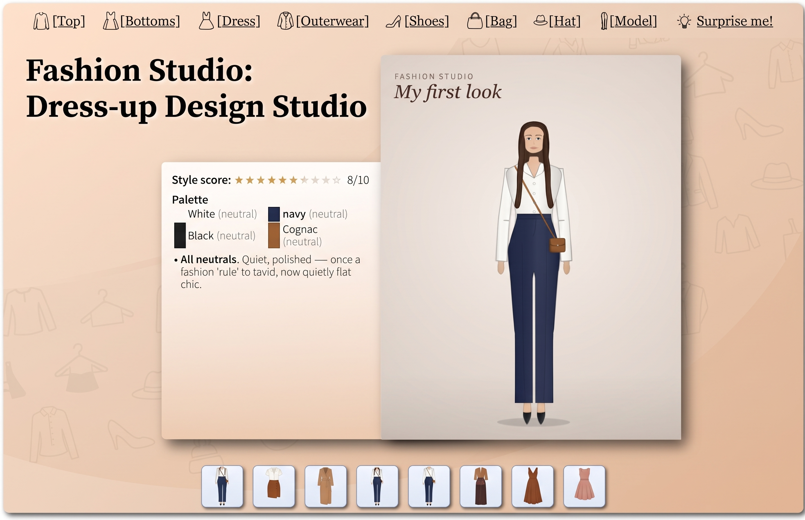
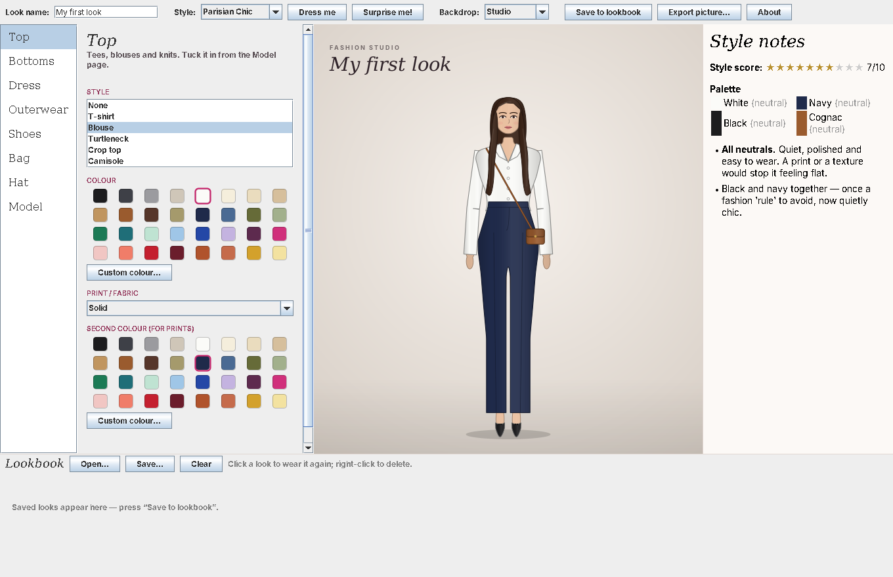

# Fashion Studio

**Dress the model, play with colour and print, and build a lookbook of your favourite outfits.**

Fashion Studio is a dress-up design studio for anyone who loves clothes. Pick a top, bottoms or a dress, add a jacket, shoes, a bag and a hat, then choose colours and prints for every piece. As you dress the model, a friendly **Style Notes** panel tells you what's working: your colour palette, whether your prints go together, which colour season the look suits, and a style score out of ten.

---

## What you can do



- **Dress the model** from seven parts of the wardrobe:
  - **Tops**: T-shirt, blouse, turtleneck, crop top, camisole
  - **Bottoms**: straight or wide-leg trousers, skinny jeans, shorts, and A-line, pencil, mini and pleated midi skirts
  - **Dresses**: shift, fit-and-flare, maxi, slip and wrap
  - **Outerwear**: blazer, trench coat, cropped jacket, cardigan, long coat
  - **Shoes**: court heels, ankle boots, knee boots, trainers, ballet flats, loafers
  - **Bags**: crossbody, tote, clutch
  - **Hats**: beret, sun hat, fedora, beanie
- **Choose from 32 named colours** (Camel, Navy, Blush, Terracotta, Emerald and more), or pick any custom colour.
- **Add a print or fabric**: Breton stripes, pinstripe, polka dots, gingham, tartan, houndstooth, herringbone, leopard, ditsy floral, denim and rib knit. Each print uses two colours that you choose.
- **Style your model**: six skin tones, six hairstyles and eight hair colours.
- **Add finishing touches**: tuck the top in, add a belt (it always matches the shoes), sunglasses or a string of pearls.
- **Get styling notes**: a style score, your outfit's palette, and tips on colour harmony, print mixing and your colour season.
- **Press "Dress me"** to try a ready-made aesthetic: Parisian Chic, Minimalist, Boho, Preppy, Y2K, Dark Academia, Quiet Luxury, Sixties Mod, Wild Thing and Coastal Summer.
- **Press "Surprise me!"** for a random outfit put together the way a stylist would: neutrals as the base, one or two accent colours, and no more than a print or two.
- **Pick a backdrop**: studio, runway, Paris, blush paper or plain white.
- **Keep a lookbook**: save looks, click a saved look to wear it again, and save your lookbook to a file to open another day.
- **Export a picture** of any look as a PNG to share.

---

## Getting started

Fashion Studio is a single file, `FashionStudio.java`. To run it, you need Java 17 or newer on your computer. Java is free, and you only need to install it once.

### On Windows

**1. Install Java**

1. Go to [adoptium.net](https://adoptium.net) and click the big download button for the latest **LTS** version. The site should pick the Windows version for you automatically.
2. Open the downloaded file (it ends in `.msi`) and click through the installer.
3. On the screen that lists features to install, check that **Add to PATH** is set to be installed. It normally is by default. This setting lets Windows find Java when you type a command.
4. Finish the installer.

**2. Check that Java is working**

1. Click the **Start** button, type `cmd` and press **Enter**. A black **Command Prompt** window will open.
2. Type the following and press **Enter**:

   ```
   java -version
   ```

3. You should see a few lines mentioning a version number of 17 or higher, for example `openjdk version "21.0.5"`.
   - If instead you see *"'java' is not recognized as an internal or external command"*, close the Command Prompt window and open a new one. Windows only notices newly installed programs in new windows. If you still get the message, restart your computer and try again.

**3. Download Fashion Studio**

1. Download `FashionStudio.java` from this page. To do this, click the file name, then click the **Download raw file** button (the arrow pointing down) at the top right of the code.
2. It will usually go into your **Downloads** folder.
3. Make sure the file is called exactly `FashionStudio.java`, with a capital F and a capital S. Some browsers add `.txt` to the end of the name. If yours did, rename it.
   - Windows often hides file endings. To see them, open File Explorer, click **View** (in Windows 11, **View → Show**) and turn on **File name extensions**.

**4. Run it**

1. Open a Command Prompt (**Start**, type `cmd`, press **Enter**).
2. Go to the folder where the file is. If it's in Downloads, type:

   ```
   cd Downloads
   ```

   and press **Enter**.
3. Now start the studio:

   ```
   java FashionStudio.java
   ```

4. After a few seconds, the Fashion Studio window will open. Keep the Command Prompt window open while you use the app. Closing it also closes Fashion Studio.

**Shortcut:** open the folder containing `FashionStudio.java` in File Explorer. Click the address bar at the top, type `cmd` and press **Enter**. A Command Prompt opens already in that folder, so you can skip the `cd` step.

**If something goes wrong on Windows**

| What you see | What to do |
|---|---|
| `'java' is not recognized…` | Java isn't installed or Windows can't find it. Open a new Command Prompt or restart your computer. If that doesn't help, run the installer again and make sure **Add to PATH** is turned on. |
| `File not found: FashionStudio.java` | The Command Prompt is in the wrong folder, or the file has a different name. Type `dir` and press **Enter** to list the files in the current folder. Check that `FashionStudio.java` is there, spelled exactly like that. |
| `error: … class FashionStudio is public, should be declared in a file named…` | The file has been renamed, for example to `FashionStudio (1).java`. Rename it back to `FashionStudio.java`. |
| A message about `unsupported class file version` or `release version 17 not supported` | Your Java is too old. Install the latest LTS version from adoptium.net. |

### On a Mac

1. Install Java from [adoptium.net](https://adoptium.net). Choose the latest **LTS** version, open the `.pkg` file and follow the steps.
2. Download `FashionStudio.java` into your **Downloads** folder.
3. Open **Terminal** (it's in Applications → Utilities) and type:

   ```
   cd Downloads
   java FashionStudio.java
   ```

The studio window will open.

---

## How to use it

**The left column** lists the parts of the wardrobe: Top, Bottoms, Dress, Outerwear, Shoes, Bag, Hat and Model. Click one to open its page. On each page you can:

- choose a **Style** from the list (choose *None* to take the piece off)
- click a **Colour** chip
- choose a **Print / fabric**
- choose a **Second colour**, which is used for the print. It is also the sole of trainers and the band or pompom of a hat.

A dress replaces the top and bottoms. To go back to separates, set Dress to *None*.

**The Model page** has skin tone, hairstyle and hair colour, and the finishing touches (tuck in, belt, sunglasses, pearls).

**The toolbar** across the top lets you name your look, try a style or a surprise outfit, change the backdrop, save to the lookbook, export a picture, and see About.

**Style Notes** on the right update every time you change something.

**The Lookbook** along the bottom shows your saved looks. Click one to wear it again, or right-click it to delete it. Use *Save…* to keep your lookbook as a `.lookbook` file and *Open…* to load it again.

---

## A few styling ideas to try

- One accent colour with neutrals is the stylist's favourite formula. Try a Navy and Ivory outfit with Red shoes.
- To mix prints, make them share a colour, for example a Navy-striped tee with a Navy gingham skirt.
- Leopard acts like a neutral, so try it with anything.
- Match your shoes and bag for a polished look, or contrast them for a more modern one.
- Wear a mini skirt or shift dress with knee boots for a sixties look.

---

## Feedback

Feature requests, bugs and suggestions are welcome: **mariogianota@protonmail.com**

---

Copyright Mario Gianota 2026. All rights reserved.

You're welcome to download Fashion Studio and use it for your own enjoyment. Please don't copy, change or redistribute it without permission.
